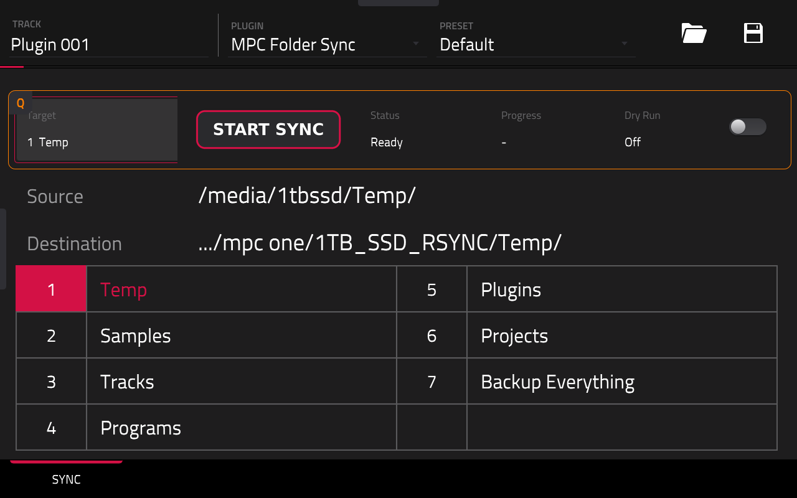

# MPC Folder Sync

An instrument plugin (shows up as a plugin program on the main screen, under "Plugins") for Akai MPC standalone devices, by Noirescripts. At the press of a button it copies a folder from the MPC to a server or NAS using **rsync over SSH**. It produces no sound. **rsync and an SSH client are bundled with the plugin** (statically built for arm32 and arm64), so the MPC does not need to provide anything.

## Using it on the MPC

One page, **SYNC**:

| Element | Function |
|---|---|
| Target | Target 1-8 from `foldersync.conf`, shown as number and job name (Q-Link 13 or tap) |
| Start Sync | Push button: one press starts the sync, shows "RUNNING" while it runs |
| Status | Display only: Ready, Running (with progress in %, e.g. "Running 45%"), Done, Failed, No rsync, No ssh, No config, Bad target, Cannot run |
| Dry Run | On = trial run (`rsync -n`), nothing is copied |
| Source / Destination | Text only (large): source folder on the MPC and destination as `user@host:folder` of the selected job |
| Job list | All jobs from the configuration in two columns of four. The selected job is marked with `>` and shown in the accent colour |

Loading a project never starts a sync by itself.



A step-by-step guide with a configuration example is in the [manual](docs/manual.md).

## Installation

Unzip the release and copy the folder `Noirescripts - VST - MPC Folder Sync` to the plugin folder (`VST2 Plugins`) of your MPC drive, the same way as for other third-party plugins. If you have the old effect version 1.0 installed, remove it first (see "Limits" below).

## Configuration

Plugins on the MPC have no text input. Address, folder and credentials are set in a text file inside the plugin folder on the MPC drive:

`Noirescripts - VST - MPC Folder Sync/Content/foldersync.conf`

```
[Backup NAS]
host   = 192.168.1.20
user   = admin
port   = 22
source = /media/MPC-Projekte/
dest   = /volume1/backup/mpc/
key    = id_ed25519
delete = no
# rsync_path = /usr/syno/bin/rsync   (only if rsync is not in the default PATH on the target)
exclude = *.tmp                       # may be repeated; patterns that are not copied
exclude = .Trashes/
```

Each `[Name]` block is one job (up to 8). The job is selected with "Target" on the MPC (the number is its position in the file). The file is read again every time you press Start Sync, so changes apply immediately. The texts on screen refresh when you change the target, after a sync, and when the plugin loads.

**Excludes:** one pattern per line (rsync syntax: `*.tmp`, `Folder/`, `Samples/Cache/`). With `delete = yes`, excluded files on the target are not deleted. The percentage is overall progress; rsync counts all files first, so very large folders take a little longer to start.

The file explains all fields in comments. The correct `source` path is shown in `Content/foldersync.log` after the first start (section "Eingehaengte Laufwerke", the list of mounted drives). Please enter the **IP address** of the target (`.local` names are not resolved).

## Login with a password (easiest)

In `foldersync.conf`, use the line `password = ...` instead of `key` (the rest of the line is used, spaces and special characters are allowed). The password is passed to the SSH client through an environment variable only, never on the command line or in the log. If `key` is set as well, the key is used. The target must allow SSH password login (common on Synology/QNAP, not on servers with `PasswordAuthentication no`). The password is stored in plain text on the drive, so use a dedicated account just for the sync.

## Login with an SSH key (more secure, one-time setup on your computer)

1. `ssh-keygen -t ed25519 -f id_ed25519 -N ""` (no passphrase).
2. Add the contents of `id_ed25519.pub` to `~/.ssh/authorized_keys` of the user on the target.
3. Put the file `id_ed25519` (private!) into the plugin's `Content` folder. It is converted automatically for the bundled SSH client (Dropbear) at sync time.
4. On first connect the target's host key is remembered (`Content/home/.ssh/known_hosts`). If it changes later, the connection is refused.

The private key is stored in plain text on the drive: use it only for a dedicated account that, ideally, can write to the target folder only. The target needs an SSH server and **rsync**.

## What happens during a sync

`rsync -rtv --partial --modify-window=2 --timeout=30 --stats --info=progress2 --no-inc-recursive` (plus `--exclude=...` per pattern and `--delete` if `delete = yes`). `-rt` is used instead of `-a` on purpose, because FAT/exFAT drives have no permissions or owners. A `/` at the end of `source` copies the contents of the folder, without it the folder itself. The full output is written to `Content/foldersync.log`.

For the duration of the sync, rsync, the SSH client and the key are copied to `/tmp` (drives are often mounted "noexec", and FAT reports all files as world-accessible) and deleted afterwards. The sync runs in its own thread, never on the audio thread.

## Limits / not tested on hardware

- Confirmed on an MPC One (Gen 1, OS 3.10.1): plugin appears under Plugins, button, status, progress, job list and a real sync work.
- Tested: build for arm32, arm64 and native, validation, host simulator, and sync against a local SSH server with the built programs (dry run, copying, deleting, OpenSSH key, password login, excludes, progress, error cases, abort, cleanup). The ARM programs themselves could not be run in the test environment.
- Text displays are limited to about 31 characters; for long paths the start is replaced by `...`.
- Plugins run unprotected inside the MPC process: save your project before the first test.
- Versions 1.1 and newer have a new plugin ID (`N2fs`). Remove the old effect version (1.0) from the `VST2 Plugins` folder first.

## Licence

Plugin code: MIT, see `LICENSE`. Not affiliated with Akai Professional or inMusic. "MPC" and "Akai Professional" are trademarks of inMusic Brands, Inc.; "VST" is a trademark of Steinberg Media Technologies GmbH.

Bundled programs: rsync 3.4.1 (GPLv3+) and Dropbear (MIT-style). Details and a pointer to the source code are in `Content/bin/THIRD_PARTY.txt`; build instructions are in `BUILDING-BINARIES.md`.

## Building

This repository contains only the plugin. To build it you need the [MPC Plugin Builder SDK](https://github.com/inmusic-software/mpc-plugin-builder-sdk) (MIT, inMusic): copy or clone this repository into `<SDK>/plugins/MPC Folder Sync/`.

```
python3 skin-src/make_skin.py      # generates skins/ (the on-screen UI)
python3 tools/build.py "plugins/MPC Folder Sync"
python3 tools/package.py "plugins/MPC Folder Sync"
```
