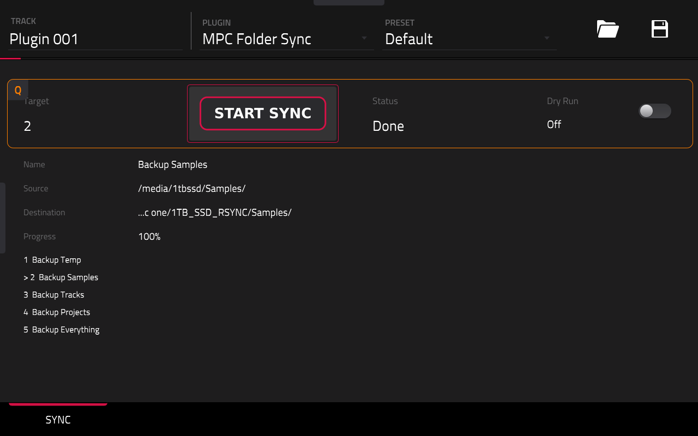

# MPC Folder Sync - Manual

## What it does

It synchronises the folders you specify over the network using rsync. rsync compares source and
target, detects what has changed and copies only those files.

## What you need

- An MPC with Developer Mode enabled
- A NAS or host with SSH
- Optional: an SSH key pair (so that no password has to be stored in plain text in the config)
- An SFTP client to copy files to the MPC (for example FileZilla)

## How to configure it

Copy the folder `Noirescripts - VST - MPC Folder Sync/` to `VST2 Plugins` on an SSD or SD card.

In the folder `Noirescripts - VST - MPC Folder Sync/Content` you will find the file
`foldersync.conf`. You can define up to 8 jobs there.

| Field | Meaning |
|---|---|
| `[Backup Temp]` | The name of the job |
| `host` | The target the files are copied to (IP address recommended) |
| `user` | The user on the target |
| `port` | 22 is the usual SSH port |
| `source` | The folder on the MPC that is to be backed up. The MPC normally mounts all "non-internal" drives under `/media/`, for example `/media/1tbssd/VST2 Plugins/`. With FileZilla (or another SFTP client) you can log in to the MPC and look up where your folder is. |
| `dest` | The complete path on the target device. An SFTP client helps here as well, or you log in with SSH, change to the folder and run `pwd`, which prints the full current path. |
| `key` | The private SSH key. Put this file into the `Content` folder. |
| `password` | If you do not use a key, enter the password of the user here. If `key` is set as well, the key is used. |
| `delete` | `yes` deletes all files on the target that are no longer in the source folder on the MPC. Default is `no`. |
| `exclude` | Folders or files that are not copied. May be repeated, one pattern per line. |

Example:

```
[Backup Temp]
host     = 192.168.1.11
user     = backupuser
port     = 22
source   = /media/1tbssd/Temp/
dest     = /srv/backups/mpc/Temp/
key      = id_rsa
# password = your-password     (instead of key)
delete   = yes
exclude  = *.bak
```

A `/` at the end of `source` copies the contents of the folder, without it the folder itself.

## How to use it



1. Select the plugin on the main screen.
2. On the far left the job number is shown. Use the first Q-Link to select the job.
3. Next to it is the **Start Sync** button. You can also start the sync with the second Q-Link of the top row.
4. Then the **Status**, which shows whether a sync is currently running.
5. The **Dry Run** switch is for testing the job without copying anything. It is also a good way
   to check the SSH login.
6. The **Target** field shows the job number and its name.
7. The **Progress** field shows the progress of a running sync in %.
8. Below that, the source and destination path of the selected job are shown in large text.
9. At the bottom is the job table with two blocks of four rows: a box with the job number, then the
   job name. The selected job has a filled number box and its name in the accent colour.
   **Tap a job to select it** (this only selects it; use **Start Sync** to run it). Selecting with the
   first Q-Link works as before. Jobs that are not in the configuration show their number and a grey `unconfigured`.

The complete output of every run is written to `Content/foldersync.log`.
